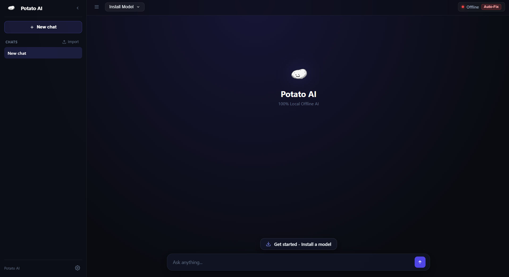
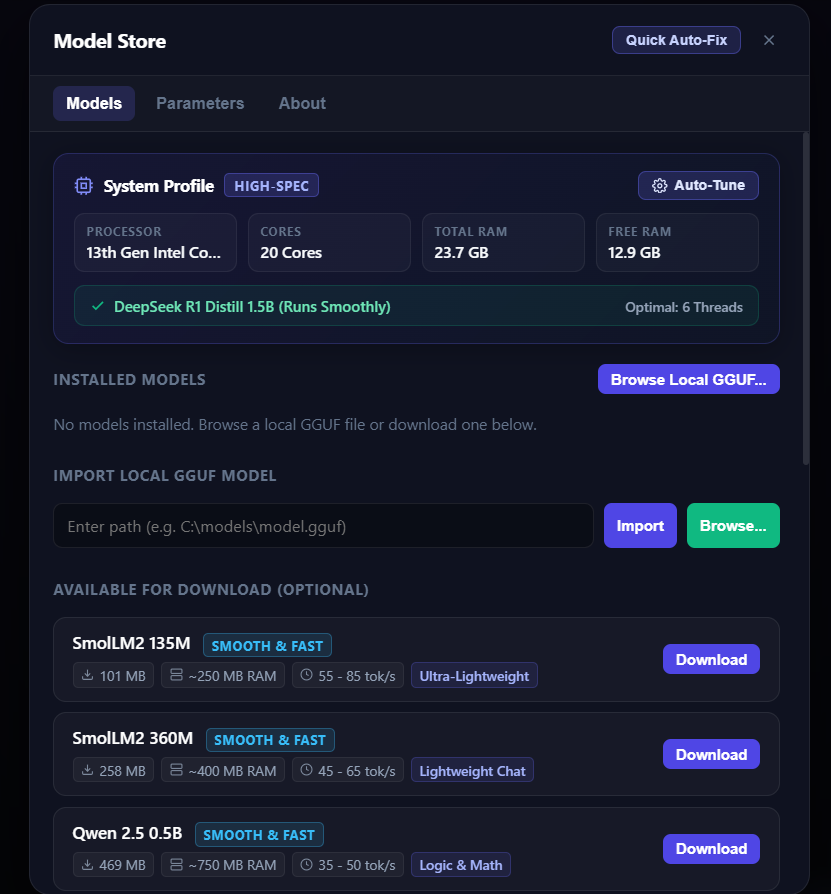
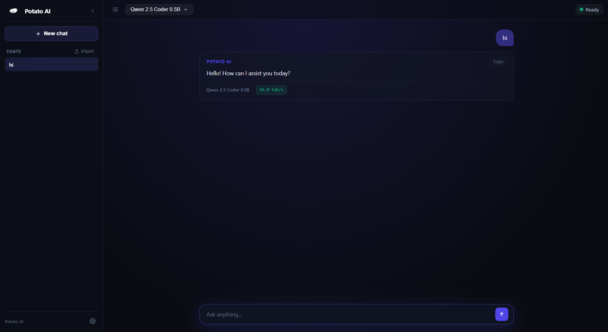

<div align="center">

  

  # Potato AI

  **Fast, 100% offline, native desktop AI built for Windows CPUs.**  
  *No GPU required · Zero telemetry · Runs from a USB pendrive*

  <br />

  [](#)
  [-emerald?style=flat-square)](#)
  [](#)
  [](#)
  [](#)

</div>

<br />

---

## Visual Showcase

### Clean Workspace & Instant Start
Launches immediately into a fresh session with one-click model setup and zero clutter.

<p align="center">
  
</p>

<br />

### In-App Model Store & System Auto-Tuning
Download curated GGUF models directly with real-time speed metrics, or import your own local `.gguf` files.

<p align="center">
  
</p>

<br />

### Fast Streaming Inference & Code Generation
Real-time token streaming with syntax-highlighted code output, generation metrics, and instant cancel.

<p align="center">
  
</p>

---

## Core Highlights

- **100% Offline & Private**: All inference runs locally on your machine CPU. Zero telemetry, zero analytics, zero external API dependencies.
- **CPU-Optimized Engine**: Built on high-performance native AVX2 / AVX-512 kernels. Runs smoothly on budget Intel Core i3/i5, AMD Ryzen, and low-spec systems.
- **Single-Click Portable**: Runs directly from any folder or USB flash drive without requiring Python, Rust, .NET, or external runtimes.
- **Embedded App Shell**: Native Windows executable (`PotatoAI.exe`) with dedicated taskbar branding, seamless window management, and zero console flashes.
- **Auto-Healing Daemon**: Built-in supervisor checks inference health every 3 seconds and automatically recovers from stalls.
- **Markdown Export & History**: Dedicated conversation history with one-click export to Markdown (`.md`) files.

---

## Curated Model Catalog

Potato AI provides an integrated one-click catalog of verified GGUF models tailored for CPU speeds:

| Model | Size | RAM Required | Typical Speed | Best For |
| :--- | :--- | :--- | :--- | :--- |
| **SmolLM2 135M** | 101 MB | ~250 MB | 55 - 85 tok/s | Ultra-lightweight assistant for older CPUs |
| **SmolLM2 360M** | 258 MB | ~400 MB | 45 - 65 tok/s | Low-RAM systems, instant concise answers |
| **Qwen 2.5 0.5B** | 469 MB | ~750 MB | 35 - 50 tok/s | Step-by-step logic and general knowledge |
| **Qwen 2.5 Coder 0.5B** | 469 MB | ~750 MB | 35 - 50 tok/s | Fast code generation and debugging |
| **TinyLlama 1.1B** | 638 MB | ~950 MB | 28 - 42 tok/s | Smooth conversational responses |
| **Llama 3.2 1B** | 770 MB | ~1.1 GB | 22 - 32 tok/s | General language, research, and writing |
| **Qwen 2.5 Coder 1.5B** | 1.1 GB | ~1.5 GB | 18 - 25 tok/s | Complex programming and multi-file logic |
| **Qwen 2.5 1.5B** | 1.1 GB | ~1.5 GB | 18 - 25 tok/s | High quality reasoning and multilingual tasks |
| **SmolLM2 1.7B** | 1.0 GB | ~1.5 GB | 18 - 25 tok/s | Summarization and structured responses |
| **DeepSeek R1 Distill 1.5B** | 1.1 GB | ~1.5 GB | 18 - 26 tok/s | Step-by-step reasoning and math problems |
| **Gemma 2 2B** | 1.6 GB | ~2.3 GB | 12 - 18 tok/s | High factual accuracy and nuanced tasks |
| **Llama 3.2 3B** | 1.9 GB | ~2.8 GB | 10 - 16 tok/s | Flagship compact model for creative writing |

*You can also import any custom `.gguf` file from your disk or paste custom Hugging Face download links.*

---

## Quick Start

### 1. Run Potato AI
Download the latest release and run:
```cmd
PotatoAI.exe
```
*(Or launch via `Run.bat`)*

### 2. Install a Model
- On first launch, click **Get started - Install a model** above the input box.
- Select any model (e.g., *Qwen 2.5 Coder 0.5B* or *SmolLM2 360M*) and click **Download**.

### 3. Start Chatting
Type your question and press `Enter`. Inference begins streaming immediately on your CPU.

---

## Keyboard Shortcuts

| Shortcut | Action |
| :--- | :--- |
| `Enter` | Send message |
| `Shift + Enter` | Insert new line |
| `Ctrl + K` / `Ctrl + N` | Start fresh conversation |
| `Ctrl + /` | Open Parameters & About modal |
| `Esc` | Close open modals or dropdowns |

---

## Architecture & Tech Stack

```
+-----------------------------------------------------------+
|                        Potato AI                          |
|  Native Windows Executable (Rust) · win32 subsystem       |
+-----------------------------------------------------------+
        |                                       |
        v                                       v
+-----------------------+              +--------------------+
|  Modern Web UI        | <--- SSE --- |  HTTP / SSE Server |
|  - Standalone Window  |              |  - Port 8765       |
|  - Glassmorphic CSS   | ---> API --> |  - System Specs    |
|  - Zero Emojis / SVG  |              |  - Auto-Tuner      |
+-----------------------+              +--------------------+
                                                |
                                                v
                                       +--------------------+
                                       |  llama-server      |
                                       |  - AVX2 / AVX-512  |
                                       |  - GGUF Quantized  |
                                       |  - Zero GPU (CPU)  |
                                       +--------------------+
```

- **Application Shell**: Native Rust executable with embedded PE icon resources.
- **Frontend**: Custom lightweight single-page interface with dark glassmorphism, responsive chat dock, and zero framework overhead.
- **Inference Runtime**: High-efficiency embedded GGML / llama.cpp engine with automated thread allocation based on detected physical CPU cores.
- **Portability**: Uses standard Windows app window mode with silent fallback browser launch.

---

## Building from Source

Requirements:
- Windows 10/11 64-bit
- Rust toolchain (`cargo`, `rustc`)
- MinGW or MSVC toolchain (`windres` or `rc.exe` for Windows resource embedding)

```cmd
git clone https://github.com/Pavankombana/Potato-AI.git
cd Potato-AI/app
cargo build --release
```

The compiled binary will be generated at `app/target/release/app.exe`. Copy it to the project root as `PotatoAI.exe`.

---

## License

Released under the [MIT License](LICENSE). Built for the local AI community.
